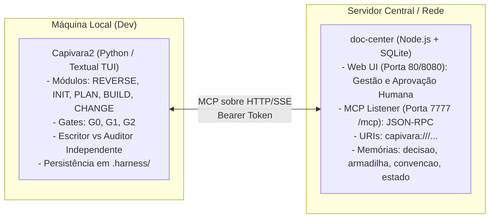

# Comparativo de Harnesses de Engenharia: Capivara (`Capivara2` + `doc-center`) vs. CLEARER (`CEH` + `dev-memory`)

## Metadados

- **Data de início:** 2026-11-02
- **Tema / palavras-chave:** harnesses de engenharia de software, Capivara2, doc-center, CLEARER Engineering Harness (CEH), dev-memory, MCP, gates determinísticos, curadoria de memória, anti-alucinação
- **Origem:** Repositórios GitHub (`RBTecNet/Capivara2`, `RBTecNet/doc-center`) compartilhados em discussão técnica sobre a visão da comunidade quanto a harnesses de IA
- **Fonte(s):**
  - Repositório `https://github.com/RBTecNet/Capivara2` (commit `0cfce94`)
  - Repositório `https://github.com/RBTecNet/doc-center` (commit `2e84606`)
  - Especificação e regras do CLEARER Engineering Harness (`~/.gemini/config/plugins/clearer-engineering/`)
  - Hub MCP de persistência e governança `dev-memory`
- **Status:** Concluída

---

## Contexto

A partir de um diálogo técnico informal sobre "qual a visão da galera quanto aos harnesses", foram apresentados dois repositórios do ecossistema RBTecNet:
1. **`Capivara2`**: Pacote Python com TUI (Terminal User Interface em Textual) implementando pipelines de desenvolvimento com gates determinísticos.
2. **`doc-center`**: Servidor em Node.js/SQLite com interface Web e listener MCP dedicado para documentação, prompts, skills e memórias.

A investigação buscou:
1. Compreender a anatomia e o modelo mental de cada repositório.
2. Identificar a mecânica exata de comunicação e complementariedade entre `Capivara2` e `doc-center`.
3. Elaborar uma análise comparativa aprofundada frente ao **CLEARER Engineering Harness (CEH)**, complementado pelo hub relacional **`dev-memory`**, determinando qual arquitetura é mais completa e por quais razões de engenharia.

---

## Verificação de fontes

| Fonte | Status | Como foi verificada |
|---|---|---|
| `RBTecNet/Capivara2` | `OBSERVED` | Clonado em `/tmp/repos_eval/Capivara2` (commit `0cfce94`), inspecionados `README.md`, `docs/DOC-CENTER.md`, `docs/CHANGE.md`, `docs/REVERSE.md`, `src/capivara2ptn/doc_center_client.py` e testes. |
| `RBTecNet/doc-center` | `OBSERVED` | Clonado em `/tmp/repos_eval/doc-center` (commit `2e84606`), inspecionados `README.md`, `docs/capivara-mcp.md`, `src/mcp/server.ts`, `src/db/schema.ts` e `src/db/store.ts`. |
| `CLEARER Engineering Harness` | `OBSERVED` | Verificado nas regras canônicas do harness (`AGENTS.md`, `core-engineering.md`, `evidence-policy.md`, `coding-policy.md`, `git-safety.md`, `security-policy.md`). |
| Hub `dev-memory` | `OBSERVED` | Inspecionados schemas de ferramentas MCP em `~/.gemini/antigravity/mcp/dev-memory/` (`memory_create`, `memory_search`, `relation_extract_propose`, `harness_provision`, `harness_hook_script`) e skill `learned-lesson`. |

---

## Análise

### 1. Anatomia do Ecossistema Capivara (`Capivara2` + `doc-center`)

O ecossistema Capivara implementa a divisão clássica entre **Agente de Campo Local (Harness)** e **Torre de Controle Remota (Knowledge Hub)**:



#### A. O Papel do `Capivara2`:
- **Interface TUI (Textual)**: Oferece navegação orientada a teclado no console (Tab, Setas, Enter), cronômetro real baseado em `time.monotonic()` e persistência hermética sob `.harness/`.
- **Pipelines Estruturados**:
  - `REVERSE`: Engenharia reversa documental de legados dividida em domínios de negócio e evidências.
  - `INIT`: Entrevista progressiva com o usuário gerando PRD validado pelo Gate G0.
  - `PLAN`: Decomposição em fases e tasks com auditoria G0 por thread.
  - `BUILD`: Execução atômica (1 task por vez) com G0 (auditoria prévia), G1 (verificação física determinística de compilação, linters e testes com exit codes reais no host) e G2 (auditoria comportamental).
  - `CHANGE`: Modo cirúrgico para manutenções pontuais diretas com auto-reparo e isolamento de arquivos modificados.
- **Dualidade Escritor (Writer) vs. Auditor**: Possibilidade de usar modelos e provedores independentes (ex: Claude como escritor e Codex/Agy como auditor de gates), combatendo viés de confirmação.

#### B. O Papel do `doc-center`:
- **Arquitetura Dual-Listener**: Roda um listener HTTP na porta 80 para a interface web de gestão e curadoria humana, e outro listener na porta 7777 dedicado exclusivamente ao endpoint MCP (`/mcp`).
- **"O Documento é a Unidade"**: Skills, hooks, documentação, prompts e memórias residem na mesma tabela unificada `documentos`.
- **Seleção por Projeto**: Um projeto vincula apenas os documentos da área geral que necessita, evitando inflar o contexto dos modelos.
- **Curadoria Humana Obrigatória**: Memórias submetidas por agentes (`registrar_memoria`) nascem obrigatoriamente com status `rascunho`. Elas só passam a compor o contexto ativo após aprovação explícita de um humano na Web UI.

---

### 2. Comparativo Completo: Capivara vs. CLEARER

| Dimensão de Engenharia | **Capivara (`Capivara2` + `doc-center`)** | **CLEARER (`CEH` + `dev-memory`)** |
|---|---|---|
| **Formato e Superfície** | **TUI Dedicada no Terminal (Python / Textual)**<br>Console interativo autocontido com cards e modais. | **Framework de Harness Agnóstico de Superfície**<br>Opera nativamente no contexto de IDEs e CLIs (Antigravity, Claude Code, Cursor, DSH). |
| **Especialização de Papéis** | **Dualidade Fixa (Escritor vs. Auditor)**<br>Dois papéis: quem implementa e quem avalia nos gates. | **Orquestrador + 6 Subagentes Especializados**<br>`ceh-investigator` (read-only), `ceh-architect` (blast radius e Zero-Decision), `ceh-implementer` (menor diff), `ceh-test-engineer` (Ponytail verification), `ceh-reviewer` (revisão adversarial) e `ceh-evidence-auditor` (juiz de claims) + Conselho de Seniores. |
| **Pipeline e Ciclo de Vida** | **Sequencial Rígido**<br>`REVERSE` → `INIT` → `PLAN` → `BUILD` ou atalho `CHANGE`. | **Adaptativo por Disciplina de Engenharia**<br>Workflows com gates próprios: `/clearer-feature`, `/clearer-bugfix` (5 gates bloqueantes), `/clearer-refactor`, `/clearer-review`, `/clearer-map`, `/clearer-audit`. |
| **Controle de Risco (Risk Dial)** | **Estático**<br>Executa o pipeline completo de gates ou o fluxo direto sem auditor. | **Dinâmico em 3 Níveis**<br>`LOW` (ágil sem burocracia), `MEDIUM` (Single-Turn End-to-End autônomo), `HIGH` (Goldfish Isolation amnésico para reviewers/auditors e aprovação humana). |
| **Validação e Testes** | **Gates G0 / G1 / G2**<br>• G0: Auditoria prévia<br>• G1: Comandos físicos com exit code<br>• G2: Aceitação | **Metodologia Ponytail Multicamadas**<br>• Escada da Menor Verificação Suficiente (Unitário → Integração → E2E)<br>• Reviewer adversarial com severidades formais (`BLOCKER` a `INFO`)<br>• Veredito de Claims (`SUPPORTED`, `PARTIALLY_SUPPORTED`, `UNSUPPORTED`). |
| **Segurança Operacional de Ambientes** | **Foco em Projeto Local**<br>Sanitização de credenciais (`Cleaner`) e opção de proibir testes automatizados. | **Matriz Granular de Ambientes**<br>• `DEV`: Liberado (`ALLOW`) com salvaguarda local<br>• `HOMOLOGAÇÃO`: Confirmação em 2 etapas (`ASK` com 2 alertas: impacto e backup/rollback)<br>• `PRODUÇÃO`: Bloqueio sumário (`DENY` incondicional) via hook físico `guard_destructive.py`. |
| **Controle de Git e CI/CD** | **Verificação de Checkpoints Locais**<br>Armazena hashes de arquivos alterados sob `.harness/`. | **Governança Estrita de Git & CI**<br>• *Pre-Push CI Gate*: Proibido push sem exit code 0 na esteira integral de CI no mesmo commit hash local.<br>• Mensagens de commit padronizadas em pt-BR (72 chars, sem emojis/co-autoria IA). |
| **Epistemologia e Prevenção de Alucinação** | **Classificação Textual**<br>Separa histórico antigo de instruções atuais. | **Epistemologia System One ("Like a Jev")**<br>7 invariantes formais: desacoplamento Conteúdo ≠ Julgamento, espaço fechado (enums), semântica física estrita `OBSERVED` / `INFERRED` / `UNKNOWN`. |
| **Economia de Tokens e Shell** | **Orçamento de Caracteres**<br>Truncamento seguro (20k/60k chars) e leitura seletiva via URIs `capivara://`. | **A Tríade de Economia de Tokens**<br>• *AST First*: Navegação por grafo AST a custo zero de LLM via Graphify.<br>• *RTK*: Compressão cirúrgica de 60-90% de saídas de terminal.<br>• *Context-mode*: Higiene ativa de sessão. |
| **Hub de Memória Integrado** | **`doc-center` (Node.js + SQLite)**<br>• Repositório documental curado<br>• Naturezas: `decisao`, `armadilha`, `convencao`, `estado`<br>• Aprovação manual de rascunhos na interface web. | **`dev-memory` (Hub Relacional & Knowledge Graph)**<br>• Busca semântica e correlações de grafos (`relation_extract_propose`, `memory_related`)<br>• Tipos: `error`, `lesson`, `best_practice`<br>• Fábrica de infraestrutura: provisionamento automático de harnesses e hooks (`harness_provision`, `harness_hook_script`). |
| **Carga Cognitiva do Desenvolvedor** | **TUI Rica**<br>Navegação por modais, barras de status e seletores de teclado. | **Ponytail Mode & Diretrizes Cognitivas (ADHD)**<br>10 heurísticas inegociáveis: ação imediata (< 2 min), tarefas numeradas, supressão de tangentes, zero preâmbulos protocolares. |

---

### 3. Veredito: Qual é o mais completo?

O **CLEARER Engineering Harness (`CEH` + `dev-memory`) é substancialmente mais completo, robusto e escalável.**

#### Fundamentação Técnica:

1. **Escopo Operacional Completo**:
   O Capivara2 foi projetado em torno de um pipeline de criação linear (`REVERSE → INIT → PLAN → BUILD`). O CLEARER abrange todas as disciplinas da rotina de engenharia em produção: investigação cirúrgica de bugs com matriz de hipóteses falsificáveis (`clearer-bugfix`), refatorações seguras sem quebra de contratos (`clearer-refactor`), mapeamento AST de arquiteturas complexas (`clearer-map`) e revisão adversarial profunda de diffs (`clearer-review`).

2. **Isolamento de Papéis e Neutralidade Epistêmica**:
   O Capivara opera com a dualidade Escritor vs. Auditor. O CLEARER desdobra o ciclo em 6 papéis especializados e aplica o **Goldfish Isolation Protocol**: subagentes de revisão e auditoria operam estritamente amnésicos/stateless, sem o viés cognitivo das discussões preliminares, avaliando apenas o diff e os testes reais.

3. **Segurança Corporativa e Integridade de Ambientes**:
   O Capivara não monitora se a execução ocorre em desenvolvimento, staging ou produção. O CLEARER possui guardrails de segurança invioláveis com interceptação física no sistema operacional (`guard_destructive.py`), bloqueio total de operações destrutivas em produção e o *Pre-Push CI Gate*, que elimina quebras de esteiras de CI remotas.

4. **Memória Relacional vs. Repositório Documental**:
   Enquanto o `doc-center` opera como um repositório SQLite com curadoria web manual de rascunhos, o `dev-memory` atua como um grafo de conhecimento relacional com busca semântica, correlação automática de entidades (`relation_extract_propose`) e capacidade de provisionar harnesses em cascata.

---

## Reflexões e inferências

- **A visão de "Harness" na comunidade:** Os repositórios da RBTecNet representam um marco importante: evidenciam que a comunidade sênior abandonou a ilusão de que prompts mágicos geram software confiável. Tanto o Capivara quanto o CLEARER consagram o princípio de que o modelo precisa de contenção externa rigorosa (harnessing), gates de aprovação e verificação física de comandos.
- **O nicho do Capivara:** O Capivara2 brilha na usabilidade para o desenvolvedor que deseja uma ferramenta de terminal fechada, com interface TUI elegante e fluxo prescritivo para construir novos produtos ou documentar legados.
- **A maturidade do CLEARER:** O CLEARER se consolida como um sistema operacional de engenharia de nível Staff/Principal Engineer, capaz de governar múltiplos modelos, garantir conformidade em esteiras de integração contínua e proteger ambientes corporativos compartilhados.

---

## Anexos

- `conversa-origem.png` — Captura da conversa técnica original motivadora da análise dos repositórios.

---

## Fechamento (contrato de resposta)

```
Resultado:   Análise aprofundada dos repositórios Capivara2 e doc-center concluída, com mapeamento de sua integração via MCP e elaboração de comparativo técnico exaustivo frente ao CLEARER Engineering Harness e ao hub dev-memory. Veredito favorável ao CLEARER em termos de completude, governança e escalabilidade.
Evidências:
  OBSERVED:  Códigos, schemas, testes, documentações e commits de RBTecNet/Capivara2, RBTecNet/doc-center, regras do CLEARER Engineering Harness e ferramentas MCP do dev-memory.
  INFERRED:  A convergência entre diferentes grupos de engenharia para padrões de gates multicamadas e separação entre escrita e auditoria comprova o esgotamento do modelo de "vibe coding" para software sério.
  UNKNOWN:   Se a RBTecNet planeja expandir o doc-center para suportar grafos de conhecimento relacionais ou se manterá o modelo documental estrito.
Confiança:   ALTA — Baseada em leitura e inspeção direta de código-fonte, endpoints e schemas nos dois ecossistemas.
```
